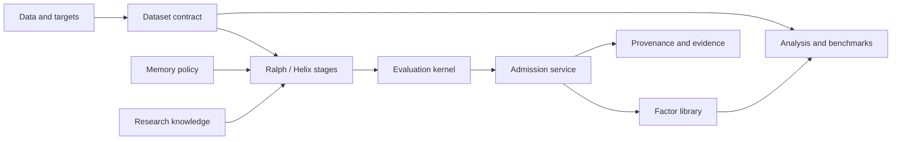

# Architecture

FactorMiner separates experiment policy, execution, admission, and persistence.
Ralph, Helix, the CLI, and MCP share engine contracts. Metric semantics are in
[reproducibility](reproducibility.md); trust boundaries are in [security](security.md).

## Execution

`Config` supplies validated hierarchical settings. `MiningRunContext` holds
execution-specific paths and target panels; loops read these through
`MiningSettings`. DataFrames use `load_runtime_dataset`; aligned arrays use
`build_runtime_dataset_from_arrays`.

`FactorGenerator` parses and validates proposals. `LoopExecutionService` runs
named stages over `IterationPayload`. Both loops construct the same generator,
`MemoryPolicy`, artifact service, and research knowledge store. Helix replaces
selected stages and adds retrieval, debate, canonicalization, or validation.

`EvaluationKernel` recomputes signals on the supplied dataset.
`LibraryGeometry` summarizes dependence and saturation; `FactorAdmissionService`
owns candidate admission and replacement, including cross-island migrants.
Saved factor scores are metadata, never substitutes for evaluation.

## Ownership

| Package | Responsibility |
| --- | --- |
| `domain` | Dependency-free numerical contracts |
| `application` | Execution context, shared workflow services, artifacts |
| `architecture` | Protocols, policies, stages, generators, reusable research contracts |
| `core` | Loops, DSL parser, expression trees, factor library, session I/O |
| `agent` | Model providers, prompts, proposal generation, debate |
| `data` | Acquisition, normalization, feature attachment, tensor construction |
| `evaluation` | Signal execution, metrics, diagnostics, admission evidence, reports |
| `benchmark` | Frozen comparisons, datasets, statistics, provenance, reporting |
| `memory` | Stores, knowledge graphs, retrieval primitives, embeddings |
| `operators` | Typed operator definitions and backends |
| `mcp` | External tools/resources over engine workflows |

`integrations/` contains agent packaging; `scripts/` contains repository checks,
demos, and the standalone benchmark entry point. Neither owns a second engine.

Domain modules cannot import higher layers. Adapter modules cannot import
application/interfaces, and application modules cannot import CLI, MCP, or
benchmark interfaces. `scripts/check_architecture.py` enforces these boundaries;
package exports are lazy and covered by import tests.

## Data and formulas

The runtime normalizes panels into `EvaluationDataset` and `DatasetContract`.
Configured target definitions and train/test periods are shared by mining,
`evaluate`, `combine`, `visualize`, and benchmark workflows.

Registered leaves include `$open`, `$high`, `$low`, `$close`, `$volume`, `$amt`,
`$vwap`, and `$returns`. Scoped feature registrations can add point-in-time
fundamentals or futures fields. The parser builds expression trees evaluated on
NumPy arrays by the shared signal runtime.

The runtime compiles trees into immutable `ExpressionPlan`s
(`core/expression_plan.py`). A plan lists the deduplicated operator steps in
order, the required features, the lookback, whether the formula needs a whole
cross-section, and a formula digest that includes `OPERATOR_SEMANTICS_VERSION`.
Mining batches and benchmark chunks (`plan_batch_size`) are compiled into a
`BatchPlan`, so each shared subexpression is evaluated once and released after
its last consumer. Each step runs the same operator code as recursive
evaluation, so outputs, NaNs, ties, warm-up values, and error messages are
unchanged. A step failure reaches only the formulas that depend on it.
`max_lookback` is the number of prior periods that can affect a value, and it
is `None` for recursive or cumulative operators. A time tile must add this
lookback before its first period. Cross-sectional operators need every asset
at each period.

Retained signal panels are identified by a `SignalKey`, which records the
dataset fingerprint, formula digest, operator semantics version, backend, and
dtype (`domain/signal_ref.py`). When `evaluation.signal_cache_mb` is set,
benchmark freezing and frozen evaluation store retained splits in a
`SplitSignalStore` (`evaluation/signal_store.py`). Artifacts then hold a
`SignalRef` whose `split_signals` mapping reads through the store. Panels
beyond the resident budget spill least-recently-used to temporary `.npy` files
and are read back exactly through read-only memory maps. A duplicate formula
shares one stored panel. `release_signals()` frees the panel but keeps the
scores and the key. Resident memory can exceed the budget by at most one
formula's retained splits while it is being stored. Admitted library factors
still hold their own signals for dependence checks. Table 1 results record
store statistics under `signal_cache`. When `signal_cache_mb` is unset, every
retained panel stays in memory, as before.

### Numerical backends

`evaluation.backend: gpu` evaluates compiled formula plans on CUDA
(`operators.torch_executor.TorchPlanExecutor`, float64). Shared
subexpressions run once per batch; window sums follow NumPy's pairwise
summation order and scalar divisions are true IEEE divisions, so 76 native
operators match the NumPy evaluator bit for bit and `exp`/`log1p`/`tanh`/`pow`
(hence Skew, Kurt) within an ulp. EMA/DEMA/KAMA, CumSum/CumProd and
column-reducing Cs operators run through the exact host dispatch, as does any
step that finds the device full (other processes may share the card; the
caching allocator is released after each batch). Feature panels upload once
per host buffer. `evaluation.gpu_device` selects the card; the device is not
part of the protocol digest because results do not depend on it. IC metrics
and dependence run on the host. Use `factorminer --gpu doctor` to verify CUDA
before a GPU campaign.

The operator registry separately accepts `backend="numpy"`, `"c"` (Bottleneck
with NumPy fallbacks), or `"torch"`. Torch operators execute on the input tensor's
device. CuPy is an optional CUDA array dependency, not the formula evaluator.
Neural leaves train on the requested device; inference uses the model's current
device unless explicitly moved. Checkpoints reload onto CPU with weights-only
loading and can then move to CUDA. The registry's `SMA` treats missing
observations as zero; `Mean` averages valid observations. Registry parity
tests are separate from the plan executor's parity tests against the
expression evaluator.

Missing data follows operator semantics `numpy-expression-v2`: a missing bar
never becomes a number (NaN denominators, empty windows and a missing latest
value give NaN; EMA-family recursions skip gaps). See the
[Qlib CN benchmark](qlib-cn-benchmark.md#missing-data).

Cross-sectional ordinal ranks break ties in asset
row order on both backends. This can change historical tied-rank results.
Candidate/library correlation instead uses average tied ranks and ranks each
column before masking paired observations. Dates with fewer than five paired
ranks are skipped; constant ranks contribute zero on otherwise usable dates.

Mining and benchmark libraries built with the `spearman` metric use
`IndexedSpearmanMetric` (`evaluation/dependence_index.py`). It returns the same
values as `SpearmanDependenceMetric`, bit for bit. Each signal is ranked once
per period. A pair re-ranks only the periods where a signal's own NaN mask
differs from the pair's joint mask. Chunking, memory layout, and reductions
match the reference. Pair results are cached, so admission, replacement,
diagnostics, and the library correlation matrix compute each pair only once.
The index identifies signals by object identity. Evaluated signals are
immutable (results aliasing an input panel are copied), and an array with no
writable buffer beneath it is fingerprinted once; others are re-validated on
every use. It drops entries when arrays are garbage-collected and bounds prepared ranks to
512 MiB (least recently used first). Run manifests report its hit counts under
`runtime_profile.dependence_index`. Pearson and distance correlation are
unchanged.

## Memory and research knowledge

`MemoryPolicy` owns schema, retrieval, formation, evolution, serialization, and
restoration. Available policies are `paper` (flat experience), `none`, `kg`,
`family_aware`, `regime_aware`, and `edit_aware`. Prompt construction uses typed
summaries; edit-aware memory receives actual parent and secondary-parent lineage.

`ResearchKnowledgeStore` separately records source decisions, structured
hypotheses, and candidate outcomes under `output/research_knowledge/`. Retrieval
uses admission yield and uncovered families, bounded by
`research.knowledge_retrieval_limit`. Source and hypothesis IDs propagate into
factor provenance and evidence packs.

With `research.planner.enabled`, the shared execution service selects generation,
refinement, advisory delay challenge, or stop after retrieval. Generation and
refinement use the normal evaluator and admission service. Challenges recompute
signals without modifying admission. See [research actions](research-actions.md).

With `research.skills.enabled`, `TransferableSkillMemoryPolicy` wraps the
configured policy and owns frozen procedure retrieval and local contradiction
review. The action service selects a kind, asks memory for a recipe, logs the
joint probability, and returns committed outcomes. Pack hashes and retrieval
settings are pinned in campaign identity. See [research skills](research-skills.md).

## Analysis and benchmarks

Analysis recomputes formulas on the requested panel and split. Dependence
strategies are explicit: `spearman`, `pearson`, or `distance_correlation`.
Optional diagnostics include significance, CPCV/PBO, decay, causal checks,
crowding, capacity, portfolios, sensitivity, and model-risk evidence.

Every non-mock provider built by `create_provider` is a `GuardedProvider`. A
failed call raises `ProviderCallError`, which carries the role (`primary` or
`draft`), provider, model, kind, and whether it can be retried. The kinds are
`auth`, `rate_limit`, `timeout`, `connection`, `bad_request`, `server`,
`missing_dependency`, and `unknown`. A failed draft call in the cascade
escalates to the primary model instead of failing the request. By default,
frozen evaluation runs XGBoost selection in a child process
(`benchmark/model_worker.py`). When lasso, stepwise, or XGBoost fails, crashes
(for example on a signal), or times out, the selection is recorded as
`status: "unavailable"` with its cause. `MethodResult` then lists it in
`unavailable` with NaN metrics, so the benchmark continues and never reports a
missing model as a measured zero.

`benchmark.runtime` coordinates comparisons. Separate modules own contracts,
provenance, datasets, mining-loop construction, frozen evaluation, statistics,
speed measurements, and reports. The CLI and `scripts/run_phase2_benchmark.py`
delegate to these services. Benchmarks include frozen Top-K evaluation,
component/strategy ablations, cost pressure, CPCV, and procedure-transfer tests.

## Persistence

Sessions persist library, memory, loop state, manifests, lifecycle/trial ledgers,
evidence, and optional signal caches. Restoration is policy-specific.

The action ledger commits each terminal outcome and its latest recovery snapshot
in one SQLite transaction. It can repair missing/torn checkpoint files. In-flight
work without a committed result is marked interrupted; campaigns require one
writer and stable dataset/protocol identity. Auxiliary stores retain their own
persistence contracts.

`EvidencePack` binds formula AST, lineage, split metrics, failure evidence,
admission decisions, source attribution, attestations, and data/config/code
hashes. Its content-derived ID supports `factorminer verify-evidence` integrity
checks. A valid hash does not establish data truth or statistical validity.
`output/` remains mutable local state; retain manifests with archived campaigns.
